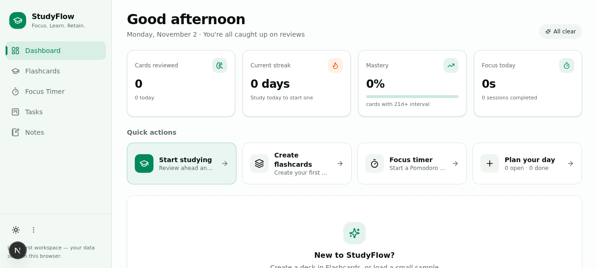

# StudyTodo 📚⚡

A modern, local-first fullstack study workspace designed to keep you focused, retain what you learn, and organize your tasks seamlessly.



## ✨ Features

- 🧠 **Spaced Repetition Flashcards**: Powered by the SuperMemo SM-2 algorithm. Create customizable decks, review cards with interactive flip animations, and track retention efficiency.
- ⏱️ **Pomodoro Focus Timer**: Integrated Pomodoro cycle (Focus, Short Break, Long Break) with audio cues, session logs, and configurable intervals.
- 📋 **Kanban Task Manager**: Organize your daily study goals across To-Do, In Progress, and Completed states with priority tags and drag-and-drop support.
- 📝 **Markdown Study Notes**: Rich notes workspace supporting GitHub-flavored Markdown, syntax highlighting, and live rendering.
- 📊 **Progress & Analytics**: Real-time study streak, daily review volume, focus duration charts, and productivity analytics.
- 🌓 **Light & Dark Mode**: Sleek UI powered by Tailwind CSS and Radix UI with automatic theme detection.
- 💾 **Local-First & Offline Ready**: All data is automatically preserved in browser storage with instant response times and zero tracking.

---

## 🚀 Live Demo

This website is automatically deployed via GitHub Actions:
👉 **[View StudyTodo Live](https://nikhiltomar2712.github.io/studytodo/)**

---

## 🛠️ Tech Stack

- **Framework**: [Next.js](https://nextjs.org/) (React 19, TypeScript)
- **Styling**: [Tailwind CSS](https://tailwindcss.com/)
- **UI Components**: [Radix UI](https://www.radix-ui.com/), [Lucide React](https://lucide.dev/), [Framer Motion](https://www.framer.com/motion/)
- **State Management**: [Zustand](https://github.com/pmndrs/zustand) & Custom React Context
- **Charts**: [Recharts](https://recharts.org/)
- **Runtime & Package Manager**: [Bun](https://bun.sh/)

---

## 💻 Local Development

### 1. Clone the repository
```bash
git clone https://github.com/nikhiltomar2712/studytodo.git
cd studytodo
```

### 2. Install dependencies
```bash
bun install
```

### 3. Run development server
```bash
bun dev
```

Open [http://localhost:3000](http://localhost:3000) with your browser.

### 4. Build for Production / Static Export
```bash
bun next build
```

---

## 🌐 Deploy to GitHub Pages

This repository includes a preconfigured GitHub Actions workflow located at [`.github/workflows/deploy.yml`](.github/workflows/deploy.yml).

To activate GitHub Pages for your repository:
1. Go to your repository on GitHub: **Settings** > **Pages**.
2. Under **Build and deployment** > **Source**, select **GitHub Actions**.
3. Every push to the `main` branch will automatically build and publish your site!

---

## 📄 License

MIT License. Feel free to use and customize for your own study routines!
